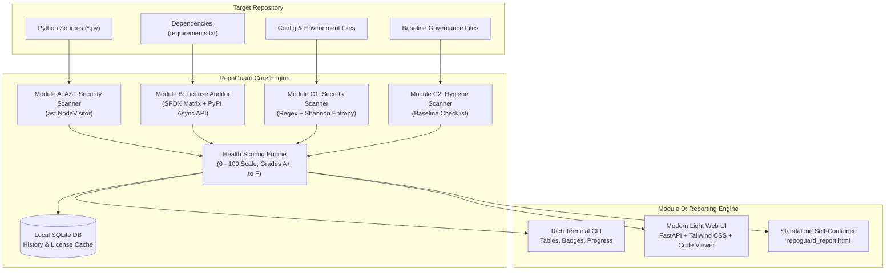

# 🛡️ RepoGuard: Protect Every Repository

**A zero-cloud, privacy-first static analysis engine that audits local repositories for AST security vulnerabilities, leaked API secrets, GPL/copyleft license conflicts, and open-source governance hygiene.**

[](LICENSE)
[](https://www.python.org/)
[](#)

---

## 1. Executive Summary & Vision

**RepoGuard** is a lightweight, zero-cloud repository compliance and security inspector. It runs local static analysis on software repositories to detect:
1. **Security Vulnerabilities**: High-risk AST constructs including `eval()`, `exec()`, `os.system()`, subprocess invocations with `shell=True`, insecure deserialization (`pickle.loads()`), and unparameterized SQL queries.
2. **Open-Source License Incompatibilities**: Restrictive copyleft licenses (e.g. GPL-3.0, AGPL-3.0) included in permissive (MIT/Apache) projects via PyPI manifest analysis.
3. **Hardcoded Secrets & Credential Leaks**: High-entropy API tokens, OpenAI keys, AWS keys, Database URLs, JWTs, and private cryptographic keys.
4. **Repository Hygiene**: Presence and substance of essential open-source health baseline files (`README.md`, `LICENSE`, `.gitignore`, `CONTRIBUTING.md`, `SECURITY.md`, `CODE_OF_CONDUCT.md`), committed `.env` files, and leftover caches.

> [!IMPORTANT]
> **Strict Local Execution:** RepoGuard executes purely on the local CPU without executing target code, running untrusted imports, or uploading code/data to external servers.

---

## 2. Architecture & System Flow



---

## 3. Core Modules Specification

### Module A: AST Security Scanner
- **Parser:** Python native `ast` library.
- **Dangerous Built-ins:**
  - `eval()`: Remote Code Execution (RCE) risk (`AST-SEC-001`, `CWE-95`)
  - `exec()`: Dynamic arbitrary code execution (`AST-SEC-002`, `CWE-95`)
  - `os.system()` & `os.popen()`: Direct shell command execution (`AST-SEC-003`, `CWE-78`)
  - `subprocess.Popen(..., shell=True)` and `subprocess.run(..., shell=True)`: Command injection (`AST-SEC-005`, `CWE-78`)
- **Insecure Deserialization:**
  - `pickle.loads()` / `pickle.load()`: Arbitrary object instantiation (`AST-DESER-001`, `CWE-502`)
  - `yaml.load()` without `SafeLoader`: Insecure YAML deserialization (`AST-DESER-002`, `CWE-502`)
  - `marshal.loads()` and `shelve.open()` (`AST-DESER-003`, `AST-DESER-004`)
- **Unparameterized SQL Injections (`AST-SQL-001`, `CWE-89`):**
  - Detected inside `cursor.execute(...)` calls:
    - String concatenation: `"SELECT * FROM users WHERE id = " + id`
    - Modulo string formatting: `"SELECT * FROM users WHERE email = '%s'" % email`
    - Formatted string literals (f-strings): `f"SELECT * FROM users WHERE id = {id}"`
    - Method formatting: `"SELECT * FROM users WHERE id = {}".format(id)`
- **Insecure Transport & Tempfiles:**
  - `requests.get(..., verify=False)`: Disabled SSL/TLS verification (`AST-NET-001`, `CWE-295`)
  - `tempfile.mktemp()`: Insecure file creation subject to race conditions (`AST-SEC-010`, `CWE-377`)

### Module B: License & Dependency Auditor
- **Project License Detection:** Inspects `LICENSE`, `LICENSE.md`, `COPYING` using SPDX signature matching (MIT, Apache-2.0, BSD-3-Clause, GPL-2.0/3.0, AGPL-3.0, LGPL-2.1/3.0, MPL-2.0, Unlicense).
- **Asynchronous PyPI Lookups:** Queries `https://pypi.org/pypi/<package>/json` asynchronously via `httpx` with local SQLite caching (`repoguard_cache.db`) and an offline pre-computed database of popular packages.
- **Compatibility Matrix:**
  - **Permissive Project (e.g. MIT, Apache)**:
    - Copyleft dependency (e.g. `GPL-3.0`, `AGPL-3.0`) -> `INCOMPATIBLE` (Critical conflict)
    - Weak copyleft dependency (e.g. `LGPL-3.0`, `MPL-2.0`) -> `WARNING`
    - Permissive dependency (e.g. `MIT`, `BSD-3-Clause`) -> `COMPATIBLE`

### Module C: Secrets & Repo Hygiene Scanner
- **Secrets Matching:**
  - OpenAI API keys (`sk-[a-zA-Z0-9_-]{20,}` / `sk-proj-...`)
  - AWS Access Key ID (`AKIA[0-9A-Z]{16}`) and Secret Keys
  - Database connection strings (`postgresql://`, `mysql://`, `mongodb://`, `redis://` with credentials)
  - JSON Web Tokens (`eyJ...`)
  - GitHub Personal Access Tokens (`ghp_...`, `github_pat_...`)
  - Slack Tokens & Incoming Webhooks
  - Private Cryptographic Keys (`-----BEGIN RSA/EC PRIVATE KEY-----`)
  - Shannon entropy thresholding ($H > 3.2$) to eliminate low-entropy placeholder variables.
  - Automatic secret masking (e.g. `sk-proj-4928••••••••••••4d9f`).
- **Repository Hygiene Checklist:**
  - `README.md`, `LICENSE`, `.gitignore`, `CONTRIBUTING.md`, `SECURITY.md`, `CODE_OF_CONDUCT.md`.
  - Flags committed environment files (`.env`, `.env.local`), compiled bytecode (`*.pyc`), and oversized binaries (>5MB).

### Module D: Dual Interface & Reporting Engine
1. **Interactive Rich CLI:**
   - Colorized severity badges (`CRITICAL`, `WARNING`, `PASS`).
   - Summary cards with Health Score, Grade, Duration, and File count.
   - Formatted tables with exact file locations and fix recommendations.
   - Progress bar with spinners.
2. **Modern Light-Theme Web Dashboard (FastAPI + Tailwind CSS):**
   - **Theme Requirement:** Strict light theme (crisp white background, subtle slate-200 borders, slate typography, emerald/amber/rose alerts, no dark theme).
   - Top stats header with circular score gauge and grade pill.
   - Repository path input with quick presets (`Vulnerable Demo`, `Clean Demo`, `RepoGuard Workspace`).
   - Tabbed results view: AST Security | License Compliance | Secrets | Repo Hygiene | Scan History.
   - **Line-by-line Code Viewer modal** highlighting the exact flagged line with line numbers and fix recommendations.
   - **One-Click Export:** Download self-contained, standalone `repoguard_report.html` and `repoguard_report.json`.
   - **Template Generator:** One-click boilerplate generation for missing hygiene files (`SECURITY.md`, `CONTRIBUTING.md`, etc.).

---

## 4. Scoring Algorithm & Health Grading

| Check | Deduction | Max Cap |
| :--- | :--- | :--- |
| Critical AST Security Issue (eval, exec, SQLi, shell=True) | -15 pts | -40 pts |
| Warning AST Security Issue | -5 pts | -20 pts |
| Critical Secret Leak (OpenAI, AWS, DB URI) | -20 pts | -40 pts |
| Warning Secret Leak (JWT, Generic) | -8 pts | -20 pts |
| Incompatible License Conflict (Copyleft in Permissive) | -20 pts | -40 pts |
| Weak Copyleft Notice | -6 pts | -18 pts |
| Missing `LICENSE` or `README.md` | -12 pts each | -24 pts |
| Missing `.gitignore` | -8 pts | -8 pts |
| Missing `SECURITY.md` or `CONTRIBUTING.md` | -4 pts each | -8 pts |
| Missing `CODE_OF_CONDUCT.md` | -2 pts | -2 pts |
| Committed `.env` file | -15 pts | -15 pts |

### Grade Scale
- **90 – 100**: `A+` (Audit Passed — Gold Standard)
- **80 – 89**: `A` (Good Compliance)
- **70 – 79**: `B` (Moderate Risk — Remediation Recommended)
- **55 – 69**: `C` (Elevated Risk)
- **0 – 54**: `F` (Critical Failures — Security & Legal Violations)

---

## 5. Quickstart & Usage

### 1. Installation
```bash
git clone https://github.com/example/RepoGuard.git
cd RepoGuard
pip install -r requirements.txt
```

### 2. Command Line Interface (CLI)

```bash
# Scan a repository directory:
python repoguard_cli.py --path samples/vulnerable_repo

# Scan and export a standalone HTML report:
python repoguard_cli.py --path samples/clean_repo --export-html repoguard_clean_report.html

# Scan and export a JSON report:
python repoguard_cli.py --path . --export-json audit.json
```

### 3. Launch the Web UI Dashboard
```bash
python repoguard_cli.py --serve --port 8000
```
Open **[http://127.0.0.1:8000](http://127.0.0.1:8000)** in your browser to interact with the visual dashboard.

---

## 6. Running the Automated Test Suite

RepoGuard includes a comprehensive test suite covering AST parsing, regex secrets, license compatibility matrices, hygiene rules, CLI exports, and FastAPI endpoints.

```bash
python -m pytest -v
```

**Results:** `24 passed in 1.77s`

---

## 7. Sample Repositories Included

- **`samples/vulnerable_repo`**: Deliberately exhibits:
  - `eval()`, `exec()`, `os.system()`, `subprocess.Popen(..., shell=True)`
  - SQL injection via concatenation, `%` format, and f-strings
  - `pickle.loads()` deserialization
  - Hardcoded fake OpenAI API key, AWS keys, Database URL, JWT
  - Copyleft licensing conflicts (`ansible`, `mysql-connector-python` vs MIT project)
  - Committed `.env` file and missing baseline governance files
- **`samples/clean_repo`**: Compliant reference repository earning **100/100 (Grade A+)**.
